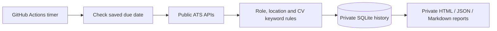

# QA Job Hunter

A scheduled Python job monitor for QA Automation, SDET, and Software Engineer in Test roles, with Indonesia-aware remote screening, CV keyword matching, and persistent deduplication.

**A rules-based automation tool.** Runs without an LLM, AI subscription, or paid search API. Runtime uses Python's standard library only. It does not send applications or scrape authenticated LinkedIn feeds.

## Features

- Reads published jobs from a configurable company watchlist using Greenhouse, Lever, and Ashby public APIs.
- Separates Indonesia/worldwide, APAC, ambiguous remote, and recognized location restrictions.
- Ranks roles using an explicit skills profile and keeps human review in the loop.
- Distinguishes publication dates from updates and first-seen dates.
- Tracks new, changed, reappeared, and no-longer-listed postings in SQLite.
- Preserves cached results when an API fails and labels their verification limits.
- Produces HTML, Markdown, and JSON reports with direct application links.
- Runs on macOS or Linux, locally or with GitHub Actions and private persistent state.

## Quick start

Python 3.11+:

```sh
git clone https://github.com/Fikriazrbni/qa-job-hunter.git
cd qa-job-hunter
cp profile.example.json profile.json
# Edit profile.json to match your CV; review the company watchlist in config.json.
python3 -m jobhunter run
python3 -m jobhunter status
```

Open `output/automatic/latest.html` in a browser. No package installation is needed when running from the repository root. The example profile is synthetic; personal profiles and search history are excluded from this repository.

## Scheduling

The default is **every 3 calendar days at 09:00 Asia/Jakarta**. A daily timer calls `tick`, which checks the saved last completion before searching. This handles month boundaries correctly. A manual `run` searches immediately and changes the schedule anchor.

On a Mac:

```sh
python3 -m jobhunter schedule install
python3 -m jobhunter schedule uninstall
```

For cloud execution, follow the [GitHub Actions guide](docs/cloud.md). Keep the code public and run the scheduler in a separate **private** repository containing the profile, SQLite history, and reports. No VPS or always-on computer is required.



## Limits

This monitors configured boards, not the entire job market. Recruiter LinkedIn posts and custom career pages need additional sources. Matching is deterministic and cannot replace a full CV/JD review. A geographic match is evidence from the listing, not a guarantee of hiring eligibility. Unknown dates remain unknown; a missing listing is not automatically declared closed. All potential matches require review before applying.

The target schedule time is not a real-time guarantee. Cloud runs can be delayed. Partial source failures remain visible in reports and workflow status.

## Tests and documentation

```sh
python3 -m unittest discover -s tests -v
```

Tests use synthetic fixtures without network requests. See [detailed usage and screening rules](docs/usage.md) and [cloud deployment](docs/cloud.md).
